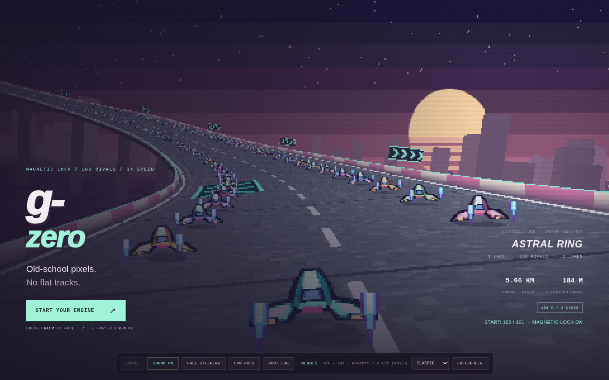

# g-zero

A high-speed magnetic racing game with original pixel art and a full 3D course.



## Play

To host the game on Vercel, [import this repository](https://vercel.com/new/clone?repository-url=https%3A%2F%2Fgithub.com%2Fmichaelcrosato%2Fg-zero). The included `vercel.json` builds and publishes `dist/`. See [Vercel deployment](docs/VERCEL.md) for settings and local verification.

Open **`index.html`** in a browser that permits local HTML and JavaScript. This is the complete game, not a builder. You can copy this one file to another device.

Three.js r181, Rapier 0.19.3, WebAssembly, artwork, sound generation, styles, and license text are embedded. The game needs no internet connection, package installation, or local server. Its content security policy blocks external connections.

WebGPU is the primary renderer. WebGL2 is the backup. The browser must support at least one backend and WebAssembly. Browser policy can block local files or graphics features. See [test limits](docs/VALIDATION.md).

## Race

There are **100 opponents and one player**. You start in **position 100 of 101**, with 99 opponents ahead and one behind. Each restart restores this grid.

Magnetic lock keeps each craft above the actual road triangles. Both edges contain the complete craft. You control the steering and can move across both lanes. There is no automatic lane centering. Light heading assistance is optional.

Astral Ring is a three-lap circuit with hills, banks, boost strips, and a recharge strip. The track is 108 meters wide, with two equal lanes. Speed settings remain three times the first prototype: 516 m/s normal and 732 m/s under boost.

| Action | Keyboard |
| --- | --- |
| Accelerate / brake | W / S or up / down arrows |
| Steer | A / D or left / right arrows |
| Boost | Shift or Space |
| Directional air brakes | Q / E |
| Realign at the current location, with a three-second penalty | R |
| Start / pause | Enter / Esc or P |
| Fullscreen / sound | F / M |

Touch controls and standard gamepads are also supported. The game fills the browser window. Native fullscreen is optional.

## Edit and build

Use Node.js 24 LTS (`nvm use`). **No `npm install` step is required.** All build dependencies are built into Node.js. The engine files are in `vendor/`.

```sh
npm run build
npm run check
```

The build writes the complete offline game to `index.html` and `dist/g-zero.html`. These files are identical. It also writes the hosted entry to `dist/index.html`, with five content-hashed engine and game files in `dist/assets/`. Commit `index.html` and `build-info.json` after a source change. `dist/` is regenerated and is not tracked.

The build is deterministic. It verifies the vendor SHA-256 values, creates the runtime checksums, and derives the build ID from the source. `npm run check` rejects an out-of-date checked-in HTML file before it runs the tests.

For an optional local preview:

```sh
npm run dev
```

Open `http://localhost:5173`. This server is for development; it is not a requirement for offline play. `PORT` changes the preview port.

To preview the exact hosted build and its cache headers, run `npm run build && npm run preview`, then open the same address. The hosted game loads assets from its own origin. The offline file continues to block network connections.

## Source layout

```text
index.html             Complete offline game for saving and local play
vercel.json            Static deployment, build verification, and cache headers
build-info.json        Version, build ID, file size, and SHA-256
game.config.json       Game name and version
src/core.js            Course geometry, grid, magnetic lock, tuning, and race math
src/assets.js          Procedural pixel art, scenery, and bitmap text
src/renderer.js        WebGPU/WebGL2 setup and the pixel output pass
src/game.js            Rapier bodies, input, opponents, camera, HUD, sound, and loop
src/ui.js              Fullscreen controls
src/template.html      Game interface markup
src/style.css          Game interface styles
boot/                  Reusable startup state machine, diagnostics, and game hooks
vendor/                Local engine modules, including the embedded WebAssembly
scripts/               Dependency-free build and optional preview server
tests/                 Unit tests and an optional browser test
docs/                  Architecture, test evidence, and publication instructions
licenses/              Third-party license text
.github/               Verification workflow and bug report form
```

Edit `src/`, `boot/`, or `game.config.json`, not the generated payloads inside `index.html`. Engine file updates require a deliberate version and manifest change. See [third-party notices](docs/THIRD-PARTY.md).

## Startup and bug reports

The plain HTML startup screen runs before the full game interface. It checks platform support, starts the renderer, starts physics, checks image orientation, creates the course, and draws the first frame. Only then does it start the game loop.

Select **BOOT LOG** to see diagnostics. Opening the log pauses a live race. On failure, the startup code, build ID, renderer, stage, and error remain visible. Save the report or take a screenshot. Reports remain on the device and are not sent automatically.

The [GAMEBOOT/1 protocol](docs/GAMEBOOT-1-PROTOCOL.md) describes the shared stage and error format. [Architecture notes](docs/ARCHITECTURE.md) describe the game integration.

## Tests

The repository includes 88 Node tests and an optional browser smoke test. The original export's validation report is retained with its limits. [Vercel deployment](docs/VERCEL.md) records verification of the hosted build.

```sh
npm run check
```

The optional browser test needs Python Playwright and an installed Chromium browser. These tools are **not** game or build dependencies:

```sh
uv run --with playwright python tests/browser_smoke.py --chromium /path/to/chromium
# With npm run preview running, check the hosted build too:
uv run --with playwright python tests/browser_smoke.py --chromium /path/to/chromium --url http://localhost:5173
```

On a Linux test host with a virtual display, `xvfb-run -a python tests/browser_smoke.py --headed` uses that display. Test files and screenshots are written to `test-results/`.

## GitHub

Public repository: [michaelcrosato/g-zero](https://github.com/michaelcrosato/g-zero).

Use [the publication instructions](docs/PUBLISH.md) to push changes with Git. The included GitHub Actions workflow checks the source, unit tests, and both build artifacts. Vercel deployment is configured separately.

## License and origin

The game code and original artwork use the [MIT license](LICENSE). Three.js uses the MIT license. Rapier uses Apache-2.0. Their license text remains in the source package and in the standalone game.

This project was previously named ION CIRCUIT. The legacy local-storage key remains unchanged so existing magnetic-race lap records are not lost. The debug API is `window.GZERO` when `?debug` is supplied. `window.ION` remains as a compatibility alias for earlier tests.

This is an original racing prototype. It contains no Nintendo artwork or audio and is not affiliated with Nintendo.
